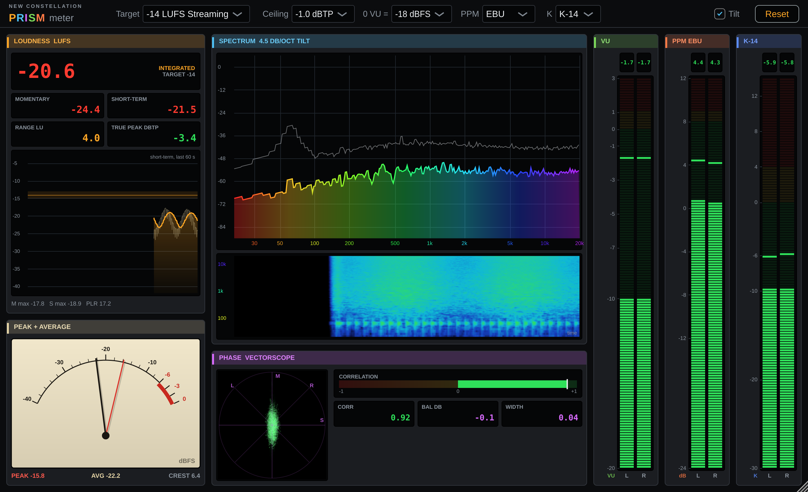

# New Constellation Prism Meter

**Prism Meter** by **New Constellation**: an all-in-one audio metering plugin that will grow into a tonal-matching and
correction tool: measure everything, capture the signature of a reference, and
correct the gap automatically, by hand, or as suggestions.

This is **Phase 1: core meters**. See the [spec](https://claude.ai/artifact/K6EhT6acdUzaH19fegY468)
for the full plan.



## What Phase 1 measures

| Meter | Details |
| --- | --- |
| Loudness | Momentary, short-term, integrated (LUFS), LRA, M/S max, per ITU-R BS.1770-5 and EBU R128 / Tech 3341 and 3342 |
| Peaks | Sample peak and true peak (4x oversampled below 96 kHz), PLR |
| VU | 300 ms ballistics, 0 VU = -20 / -18 / -14 / -12 / -10 dBFS |
| PPM | EBU, BBC (Type II) and DIN, Nordic (Type I) ballistics |
| K-System | AES17 RMS on K-20, K-14, K-12 scales |
| Peak + average | Dual-needle gauge (our design): peak and RMS needles on one scale, crest factor readout |
| Spectrum | 8192-point FFT, log frequency, averaging, peak hold, 4.5 dB/oct tilt, frequency-coloured trace |
| Spectrogram | Scrolling time vs frequency heat map under the spectrum |
| Phase | Vectorscope (mid/side) with phosphor persistence, correlation, balance, width |
| Loudness history | Last 60 s of short-term and momentary loudness against the target band |

Each tool has its own accent colour (loudness amber, spectrum sky, phase violet,
VU green, PPM orange, K-System blue), and level meters use segmented
green / yellow / red bars.

Loudness targets: -14 LUFS streaming, -16 podcast, -23 EBU R128, -24 ATSC A/85, with a
true-peak ceiling of -0.1, -1 or -2 dBTP.

## Layout

```
core/      Pure C++20 DSP library, no JUCE dependency (prism_core)
tests/     GoogleTest unit and compliance tests for core/
plugin/    JUCE 8 plugin: processor, editor, meter views
tools/     PrismSnapshot: renders the editor to a PNG with a test signal
```

The DSP lives in `core/` so it can be tested quickly without a host. The audio
thread never allocates or locks: readings reach the UI through atomics and the
spectrum through a lock-free FIFO.

## Building

Prism Meter targets **macOS** (universal binary, Apple silicon and Intel, macOS
10.13+) as **VST3 and AU**. AAX comes at the end of the roadmap. Linux builds
are kept working for development and tests only.

Requires CMake 3.22+ and a C++20 compiler (Xcode 15+ on macOS). JUCE 8.0.9 and
GoogleTest 1.15.2 are downloaded at configure time.

```sh
# Core library and tests only (fast)
cmake -S . -B build -DPRISM_BUILD_PLUGIN=OFF
cmake --build build --parallel
ctest --test-dir build --output-on-failure

# Plugin (VST3 + AU + Standalone on macOS)
cmake -S . -B build -DCMAKE_BUILD_TYPE=Release
cmake --build build --config Release --parallel

# Check the AU with Apple's validator
cp -R "build/plugin/PrismMeter_artefacts/Release/AU/Prism Meter.component" ~/Library/Audio/Plug-Ins/Components/
auval -v aufx PrMt NwCn
```

Plugin identity: manufacturer "New Constellation" (code `NwCn`), product
"Prism Meter" (code `PrMt`), bundle ID `com.newconstellation.prismmeter`.
These codes are saved in users' sessions, so don't change them after release.

Options:

- `PRISM_JUCE_DIR=/path/to/JUCE` uses a local JUCE checkout instead of downloading.
- `PRISM_AAX_SDK=/path/to/aax-sdk` adds the AAX format early (planned for later; needs an Avid developer account and PACE signing).
- `PRISM_BUILD_SNAPSHOT_TOOL=ON` builds `PrismSnapshot`.

On Linux (development only) install the JUCE dependencies first: `libasound2-dev
libfreetype-dev libfontconfig1-dev libx11-dev libxrandr-dev libxinerama-dev
libxcursor-dev libxcomposite-dev libxext-dev libgl1-mesa-dev`.

## Standards and clean-room approach

Behaviour is built from public standards (ITU-R BS.1770-5, EBU R128, EBU Tech
3341 and 3342, IEC 60268-10 and -17, AES17), published documentation, and what
existing meters visibly do. No proprietary code, binaries, assets or UI designs
are copied. Where the standards leave room, the choices are ours and are marked
"our design" or "our calibration" in the code:

- True-peak interpolator: Kaiser-windowed sinc, 32 taps per phase.
- VU: critically damped model, no needle overshoot.
- PPM: attack constants calibrated to the IEC tone-burst targets, steady-tone offset corrected.
- Peak + average gauge: the whole meter.

## Licensing

New Constellation uses JUCE under its free licence tier. That tier has a revenue
limit and its own terms, so check the current terms at juce.com before
releasing, and move to a paid JUCE licence if the limit is reached. Release
builds for macOS also need a Developer ID signature and notarization.
